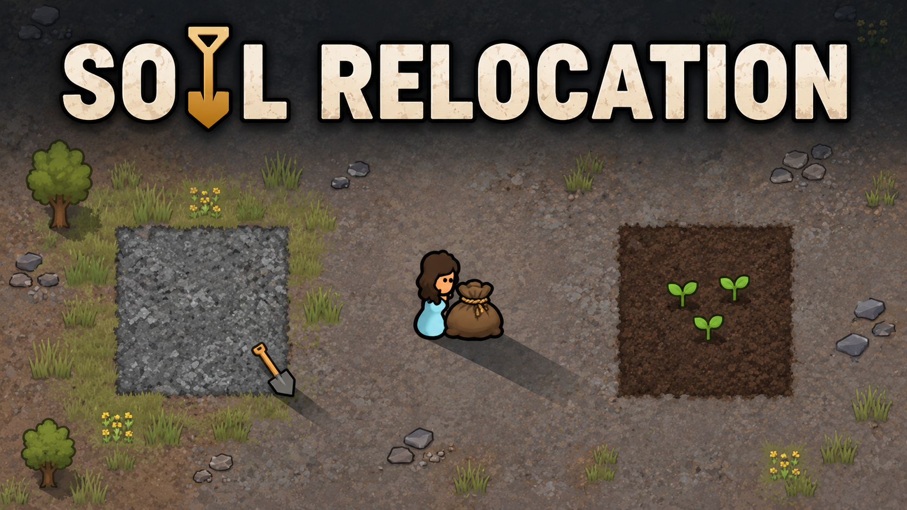

# [Soil Relocation](https://steamcommunity.com/sharedfiles/filedetails/?id=3796857604)



**Dig up soil and move it where you need it**

A RimWorld mod that lets colonists dig up supported soil-like terrain, haul it as a resource, and place it somewhere else.

## Features

- Dig up and relocate Sand, Gravel, Soil, and Rich Soil.
- Each successfully dug tile gives one matching haulable resource, and each successfully placed tile uses one resource.
- Dig supported local terrain such as lichen-covered soil and riverbank tiles.
- Digging removes the supported soil-like terrain and restores the natural rock or ice expected at that location.
- Choose whether placed terrain uses its standard version or matches the local biome when possible.
- Colonists haul dug material to Place orders before actual relocation work begins.
- Dig and Place use the dedicated **Relocate** work type in the Work tab.
- Work amount, affected skills, XP gain, and relocation under conduits are configurable.
- Ordinary cancellation integrates with RimWorld's native Cancel designator and standard Cancel hotkey.
- Optional Allow Tool compatibility extends its bulk cancellation actions to relocation orders without creating a required dependency.

## Requirements and installation

- RimWorld **1.6 or 1.7**.
- [Harmony](https://steamcommunity.com/sharedfiles/filedetails/?id=2009463077) for your game version. Load Harmony before Soil Relocation.
- The base game is sufficient. Odyssey adds terrain variants and placement surfaces.

For a manual installation, download the complete mod package attached to a [GitHub Release](https://github.com/EscarvalOokt/SoilRelocation/releases) and place it in `RimWorld/Mods/SoilRelocation/`, with `About/` directly inside that folder. Enable a compatible Harmony version before Soil Relocation in the Mods menu, then restart the game.

When building from source, use [deployment](#deploying-a-development-build) to prepare a complete package. The repository's `mod/` directory and GitHub's automatic source archives are not contain the current DLL.

To update a manual installation, close RimWorld and replace the installed mod folder with the complete package. Keep only one copy of Soil Relocation enabled.

If you plan to continue an existing save without Soil Relocation, follow the [removal procedure](#removing-from-an-existing-save).

## Usage

1. In the Work tab, enable **Relocate** for digging and placing and **Haul** for delivering material. Different colonists can do these jobs.
2. Open **Architect → Floors** and select **Dig terrain** from the relocation dropdown. Mark supported terrain to turn it into a haulable resource.
3. Choose **Place sand**, **Place gravel**, **Place soil**, or **Place rich soil** from the same dropdown and mark an eligible destination. Place work starts once a hauler brings one matching resource to the order. Make sure a hauler can reach the resource and the destination.

Use **Cancel** to remove a Dig or Place order.

## How it works

```text
Place order
→ haul one matching resource to the destination
→ Relocate work
→ place the terrain, using the delivered resource
```

An existing order can wait for a fire to go out or a plant to be cleared. The mod cancels a Place order if its destination becomes permanently unsuitable. Cancelling a Place order after delivery returns the delivered resource.

## Supported terrain

| Hauled resource | Terrain to dig | Standard terrain placed |
| --- | --- | --- |
| Sand | Sand | Sand |
| Gravel | Stony soil | Stony soil |
| Soil | Soil, lichen-covered soil, and the soil variants from Glowforest and Grassland | Soil |
| Rich soil | Rich soil, riverbank | Rich soil |

The Glowforest and Grassland soil variants come from Odyssey and appear as **soil** in-game. Terrain that changes as it dries must first dry into a supported terrain type before it can be dug up.

Other mods can add terrain to these four groups. [Terrain extension rules](docs/architecture.md#third-party-family-membership)

## Placement destinations

Relocated terrain can be placed on rough, rough-hewn, and smoothed natural rock, including Granite, Marble, and Slate.

You can also place terrain on Ice. Odyssey adds Volcanic Rock and Smooth Volcanic Rock as placement surfaces.

Constructed floors such as stone tile and flagstone, Thin Ice, Cooled Lava, and deep or shallow lava are ineligible.

## Settings

Open **Options → Mod Settings → Soil Relocation**.

| Setting | Supported values | Default |
| --- | --- | --- |
| Placed terrain type | `Standard`, `Match local biome` | `Standard` |
| Allow relocation under conduits | On / Off | Off |
| Digging work required | `50..5000`, step `10` | `1000` |
| Placement work required | `50..5000`, step `10` | `1000` |
| Digging skills | Any selection of Mining, Construction, Plants, or none | None |
| Placement skills | Any selection of Mining, Construction, Plants, or none | None |
| Skill XP rate | `0.03..0.30`, step `0.03` | `0.09` |

**Match local biome** uses the matching local terrain when the biome provides a clear choice for that material. Otherwise it uses **Standard**.

If no skill is selected, the operation uses general work speed and grants no skill XP. A colonist must be able to use every selected skill for the task. If several skills are selected, their effective work speeds are averaged and the available XP is divided between them.

Changes to work amount, selected skills, and XP settings affect newly started relocation work rather than changing work already in progress. Changes to conduit permission or the placed terrain type can affect an existing order the next time the mod checks it.

## Compatibility

Allow Tool is optional. With a compatible version of Allow Tool, **Cancel selected** and **Cancel designations** also work on Dig and Place orders.

When moving a save from RimWorld 1.6 to 1.7, back up the original save and install the complete Soil Relocation package. Open a copy in RimWorld 1.7 with Harmony and Soil Relocation enabled.

### Adding to an existing save

Adding the **Relocate** work type can shift previously stored Work-tab priorities when the work-type order changes. Soil Relocation does not migrate these priorities. Review the Work tab after adding the mod to an existing save and correct any affected priorities manually.

### Removing from an existing save

Removing Soil Relocation from an existing save is supported **with preparation**. Stop all active Soil Relocation Dig and Place work before removing the mod. Removing it while a pawn is working can leave that pawn in an invalid state on load and cause recurring errors.

Before disabling the mod:

1. Make a backup of the save.
2. Keep Soil Relocation enabled and cancel all remaining Soil Relocation Dig and Place orders.
3. Confirm that no pawn is actively performing Soil Relocation work.
4. When practical, remove or consume remaining portable relocation resources; they cannot survive removal of the mod that defines them.
5. Save the game, then exit RimWorld completely.
6. Disable Soil Relocation before loading the save. If you use the in-game Mods menu, restart after applying the change.
7. Load the prepared save. The first load may report missing Soil Relocation data, including the map component that records natural rock.
8. If the map loads normally, save under a new name with Soil Relocation still disabled, exit, and reload the new save. Keep the original backup until you have checked that copy.

Soil Relocation does not provide automatic migration or repair for an already corrupted post-removal save.

### Known limitations

- The map Forbid and Unforbid tools act on items. Select a relocation order to use its Allow/Forbid toggle.
- Dig is limited to the supported soil-like materials. Water, ice, natural rock, and constructed floors cannot be moved.

## Languages

- English
- Russian
- Ukrainian

## Development

### Prerequisites

- .NET 10 SDK.
- RimWorld 1.7 installation with `Assembly-CSharp.dll` and `UnityStubs.dll`.
- The `0Harmony.dll` supplied by a Harmony installation for RimWorld 1.7.

The source builds the `net10.0` DLL for 1.7. The package also includes the DLL for RimWorld 1.6.

### Local configuration

Copy the [example configuration](docs/SoilRelocation.Local.props.example) to `src/SoilRelocation.Local.props`. This file contains machine-specific paths and is ignored by Git.

- Set `RimWorldManagedDir` to the directory containing both RimWorld 1.7 DLLs. On Windows, use the game installation root.
- Set `HarmonyDllPath` to the full path to the DLL that Harmony's `LoadFolders.xml` selects for RimWorld 1.7.
- Set `RimWorldModAssembliesDir` only when you need deployment. Use the absolute destination path ending in `Current/Assemblies` with that casing.

### Build

```powershell
dotnet build src/SoilRelocation.sln -c Release
```

The current DLL is built to `src/SoilRelocation/bin/Release/SoilRelocation.dll`. `DeployToGame` defaults to `false`. The solution also builds the runtime probes and copies each probe DLL to its test mod's ignored `Assemblies/` directory under `tests/`.

### Deploying a development build

Close RimWorld before updating its installed mod. Set `RimWorldModAssembliesDir`, then run from the repository root.

```powershell
dotnet build src/SoilRelocation.sln -c Release -p:DeployToGame=true
```

The mod root is two levels above the configured assemblies directory. Deployment copies `About/`, shared Defs, patches, languages and textures, and `LoadFolders.xml`. RimWorld 1.6 loads `1.6/Assemblies/SoilRelocation.dll`, while 1.7 loads `Current/Assemblies/SoilRelocation.dll`. Both load the shared content from the package root.

Choose an empty directory or an installation whose `About/About.xml` identifies Soil Relocation. Deployment stages the complete package alongside the destination and verifies the historical DLL checksum. It preserves files outside managed paths and retains a local `About/PublishedFileId.txt` when the source supplies no ID. Top-level `Assemblies/` and `1.7/` are managed and removed during the update. If deployment is interrupted, rerun the same command to recover and finish the update. [Deployment targets](build/ModDeployment.targets)

If the build succeeds with a `Deployment cleanup deferred` warning, the new package is installed. If another application has the reported path open, close it and repeat the deploy to finish cleanup.

To prepare a release candidate, deploy to a clean external staging directory. ZIP the contents of the resulting mod folder with `About/` at the root of the archive. For manual installation, extract that archive into `RimWorld/Mods/SoilRelocation/`.

```powershell
dotnet build src/SoilRelocation.sln -c Release -p:DeployToGame=true -p:RimWorldModAssembliesDir="C:\ModStaging\SoilRelocation\Current\Assemblies"
```

### Tests

```powershell
dotnet test tests/SoilRelocation.Tests/SoilRelocation.Tests.csproj -c Release
```

Use the default `DeployToGame=false` for automated tests. For the package and in-game checks, see the [testing policy](docs/testing.md).

## Technical documentation

- [Architecture](docs/architecture.md)
- [Testing policy](docs/testing.md)